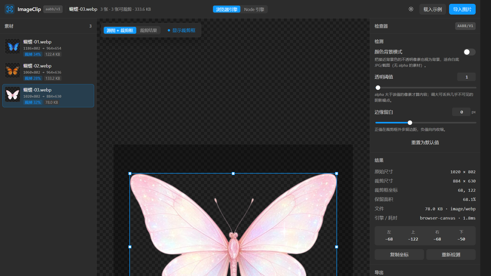
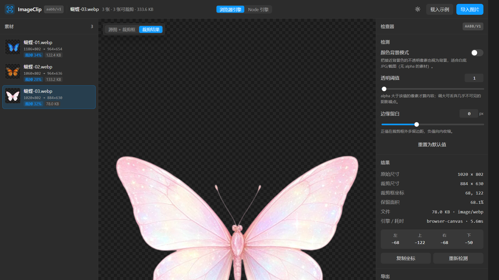
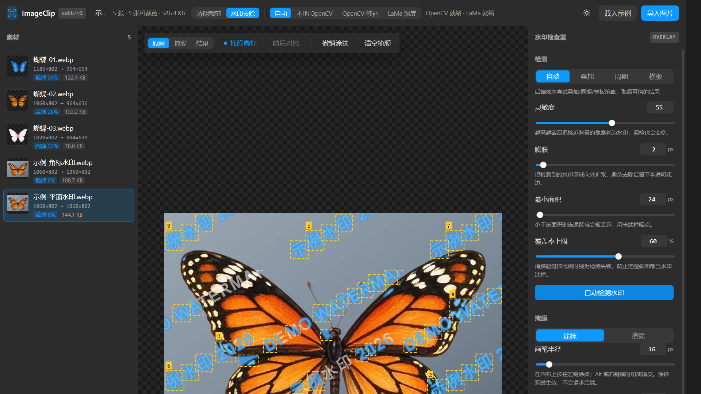
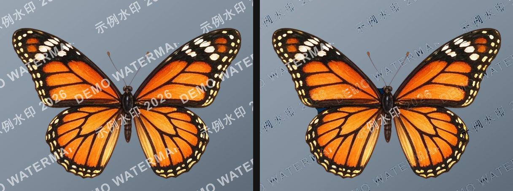

# ImageClip · 透明区域裁剪 + 水印识别去除

Node + Vue 的图片处理应用。当前版本聚焦一个功能：

> **AABB 自动识别透明区域并切割图片** —— 扫描图片所有不透明像素，算出最小外接矩形
> （axis-aligned bounding box），把四周的透明区域整块切掉。

界面参考 Figma：左侧素材面板、中间棋盘格画布（带选择框 + 8 个手柄 + 尺寸标签，
被裁掉的区域会压暗显示）、右侧检查器、底部状态栏。





---

## 1. 快速开始

```bash
npm install          # 安装 server + web 两端的依赖
npm run dev          # 同时启动 Node API(8787) 和 Vite 前端(5173)
# 打开 http://127.0.0.1:5173
```

生产模式（同一个 Node 进程同时托管 API 和前端产物）：

```bash
npm run build        # 构建 web/dist
npm start            # http://127.0.0.1:8787
```

打开后点 **载入示例** 会把 `samples/` 里的三张蝴蝶图读进来看效果；也可以直接把图片
拖进画布、`Ctrl+V` 粘贴、或点「导入图片」。

其它命令：

| 命令 | 作用 |
| --- | --- |
| `npm test` | 算法单测 + 服务端接口集成测试（33 项） |
| `npm run verify` | 用 `samples/` 真图跑一遍，打印各阈值下的 AABB 并输出裁剪结果 |
| `npm run dev:web` / `npm run dev:server` | 只启动前端 / 只启动后端 |

---

## 2. 目录结构

```
image-clip/
├─ shared/aabb.js          ★ 核心算法：AABB 检测（零依赖，前后端共用同一份源码）
├─ shared/aabb.test.js       算法单测（19 项，构造像素级 fixture）
├─ server/
│  ├─ src/imaging.js          sharp 解码 → RGBA → 调 shared/aabb → 裁剪编码
│  ├─ src/index.js            Express API + 生产环境静态托管
│  └─ test/api.test.js        真实起 HTTP 服务的集成测试（14 项）
├─ web/
│  ├─ src/components/         TopBar / AssetPanel / StageCanvas / InspectorPanel / StatusBar
│  ├─ src/composables/useWorkspace.js   全部状态与动作
│  ├─ src/lib/imaging.js      浏览器解码 / 检测 / 裁剪导出
│  ├─ src/lib/engine.js       浏览器引擎 ↔ Node 引擎的统一契约
│  ├─ src/lib/zip.js          纯 JS 打包 ZIP（批量导出，无第三方依赖）
│  ├─ scripts/vite-runner.mjs 受限环境下的 Vite 启动器（见 §6）
│  └─ vite.noesbuild.config.js 无 esbuild 构建配置（见 §6）
├─ samples/                  示例图片（用户提供的三张蝴蝶，含 alpha）
└─ scripts/verify-samples.mjs 真图回归脚本
```

---

## 3. 算法：AABB 透明区域检测

`shared/aabb.js` 只做一件事，但被严格定义：

```js
detectBounds(rgba, width, height, options) → {
  bounds:  { x, y, width, height },     // 要保留的矩形（像素）
  trimmed: { left, top, right, bottom },// 四边各切掉多少像素
  empty, contentPixels, contentRatio, options
}
```

* **输入是“直通 RGBA”字节**：`width*height*4`，与浏览器 `canvas.getImageData()`、
  Node `sharp().ensureAlpha().raw()` 的输出完全一致。**同一份源码同时跑在两端**，
  这是客户端与服务端结果可以逐像素对齐的根本原因（见 §5 验证）。
* **判定规则**：`alpha > alphaThreshold` 的像素算内容（默认阈值 1，即“非全透明就算内容”）。
  颜色背景模式下追加一条：不透明但 RGB 与 `backgroundColor` 的三通道最大差值 ≤
  `colorTolerance` 的像素也算背景 —— 用于没有 alpha 的白底 JPG/截图。
* **逐像素精确扫描**，不做抽样加速。抽样的“加速版”会漏掉细小的孤立内容、
  甚至把整张图判成空，因此被明确移除（`aabb.test.js` 里有对应的回归用例）。
* `padding` 支持正负：正数向外扩（保留呼吸位），负数向内收（裁掉抗锯齿边缘）。
  结果会被夹取在图片范围内。
* 越界参数会被**收敛**而不是抛错（`alphaThreshold` 夹到 0–255，`padding` 取整…），
  原始参数快照会随结果一起返回，便于复现。

### 阈值怎么选

三张示例图在各阈值下的实测结果（`npm run verify`）：

| 图片 | 阈值 | 原始 | 裁剪后 | 四边去除 (左/上/右/下) | 保留面积 |
| --- | --- | --- | --- | --- | --- |
| 蝴蝶-01.webp | 0/1/8 | 1186×802 | **964×654** | 170 / 114 / 52 / 34 | 66.3% |
| 蝴蝶-01.webp | 16/32 | 1186×802 | 962×654 | 170 / 114 / 54 / 34 | 66.1% |
| 蝴蝶-02.webp | 0/1 | 1060×802 | **964×636** | 48 / 116 / 48 / 50 | 72.1% |
| 蝴蝶-02.webp | 8/16 | 1060×802 | 962×636 | 50 / 116 / 48 / 50 | 72.0% |
| 蝴蝶-03.webp | 0/1 | 1020×802 | **884×630** | 68 / 122 / 68 / 50 | 68.1% |
| 蝴蝶-03.webp | 8/16 | 1020×802 | 882×630 | 70 / 122 / 68 / 50 | 67.9% |

这类素材边缘干净，阈值 0~16 差别只有 1–2 像素；**默认 1** 最保守（不切内容），
若素材带很淡的投影噪点，把「透明阈值」往上调即可丢弃。

---

## 4. HTTP API（Node 侧）

| 方法 | 路径 | 说明 |
| --- | --- | --- |
| GET | `/api/health` | 引擎能力：`sharp` 版本、算法标识、限制、默认参数 |
| GET | `/api/options` | 默认检测参数契约 |
| GET | `/api/samples` | `samples/` 清单（含中文文件名） |
| GET | `/api/samples/:name` | 读取示例原图（带路径穿越防护） |
| POST | `/api/analyze` | 检测 AABB → JSON |
| POST | `/api/crop` | 裁剪 → 图片二进制（`?response=json` 返回 dataURL） |
| POST | `/api/crop/batch` | 批量裁剪 → 逐张结果（单张失败不影响其它） |

请求体支持两种形式：

```bash
# ① 原始二进制 + query 参数
curl -X POST 'http://127.0.0.1:8787/api/crop?alphaThreshold=8&padding=2&format=png' \
     -H 'Content-Type: image/webp' --data-binary @samples/蝴蝶-01.webp \
     -o out.png

# ② JSON + dataURL
curl -X POST http://127.0.0.1:8787/api/analyze \
     -H 'Content-Type: application/json' \
     -d '{"image":"data:image/png;base64,...","options":{"matchColor":true,"colorTolerance":30}}'
```

检测参数（query 或 `options` 均可）：`alphaThreshold`、`padding`、`matchColor`、
`backgroundColor`、`colorTolerance`、`sample`（已无此参数）；输出参数：
`format`（`png`/`webp`/`jpeg`/`avif`/`source`）、`quality`。
二进制响应会带 `X-Image-Clip-Bounds`（base64 JSON）、`X-Image-Clip-Engine`、
`X-Image-Clip-Algorithm` 头。

错误统一为 `{ "error": { "code", "message" } }`：`UNSUPPORTED_FORMAT`(415)、
`EMPTY_CONTENT`(422)、`BAD_FORMAT`(400)、`PAYLOAD_TOO_LARGE`(413)…

---

## 5. 双引擎与一致性验证

界面上可以切换 **浏览器引擎**（`browser-canvas`，本地即时、不上传图片）和
**Node 引擎**（`node-sharp`，POST 到服务端）。两者调用同一个 `shared/aabb.js`，
所以在同一张图上会给出**完全相同**的 AABB —— 实测（蝴蝶-03，阈值 1）：

```
浏览器引擎: 1020×802 → 884×630 @ (68, 122)   5.6ms
Node 引擎 : 1020×802 → 884×630 @ (68, 122)   45ms
```

如果 Node 服务没启动，切到 Node 引擎会自动回退到浏览器引擎并在结果里标注，
不会让界面卡在错误状态。

### 已验证的行为（不是"应该能跑"）

* `npm test` —— **92 项全绿**：
  * 算法 19 项（裁剪）：四周边距、单像素角落、不规则形状、整图透明、阈值边界（`>` 与 `>=` 的区别）、
    正负 padding 夹取、颜色背景模式及容差、非法缓冲区报错、参数收敛。
  * 掩膜 16 项 + 指标 6 项 + 反混合 7 项（水印）：腐蚀/膨胀/开闭/羽化、连通域、RLE 编解码、
    PSNR/SSIM、不透明度估计与还原。
  * 服务端 26 项：裁剪 14 项（真实 HTTP 服务上的检测/裁剪/批量/多格式输出/错误码，以及
    **CMYK JPEG**、**调色板 PNG** 的规范化路径）+ 水印 12 项（检测精度、反混合还原、
    三种不透明度、显式掩膜、掩膜尺寸对齐、空掩膜报错、干净图不误检、模板定位、LaMa 回退与真实推理）。
  * 前端 18 项：ZIP 打包 3 项 + 水印掩膜算法与 API 载荷 15 项。
* `npm run verify` —— 真实示例图跑通并输出裁剪结果到 `probe-out/`。
* `npm run verify:watermark` —— 合成水印的量化报告（IoU/精确率/召回率 + PSNR/SSIM），
  结果图输出到 `probe-out/watermark/`。
* 浏览器端到端（Chrome 155 + Playwright 驱动真实点击）：
  * 裁剪：导入三张示例 → 浏览器引擎得出 884×630 @(68,122) → 切 Node 引擎得到同一结果 →
    切「裁剪结果」视图 → 状态栏显示 `Node 服务端已连接 · sharp 0.34.5`。
  * 水印：切「水印去除」→ 载入示例 → 选 `示例-平铺水印.webp` → 自动检测水印
    （覆盖 11.69% / 置信度 100% / 64 个候选区域）→ 执行去除（**unblend · 431ms**）→
    切「结果」视图拿到 1.17 MB 输出，下载与打包按钮可用。

---

## 6. 水印识别与去除

界面上切到 **水印去除** 模式即可：检测 → 掩膜（自动/手涂）→ 去除 → 导出。
这一节说明它到底怎么工作、数字是多少、以及**哪些情况它做不了**。

### 6.1 关键结论：半透明水印要"反混合"，不要"修补"

水印是叠加：`I = α·W + (1−α)·B`。要还原底图，应当**解方程**：

```
B = (I − α·W) / (1 − α)
```

而不是把掩膜区域"涂掉重画"。实测（合成 α=0.35 的白色水印，640×480）：

| 处理方式 | 掩膜区 PSNR | 掩膜区 SSIM | 说明 |
| --- | --- | --- | --- |
| 带水印（基线） | 19.65 dB | — | — |
| OpenCV 修补（Telea） | 22.9 dB | 偏低 | 把内容糊掉，纹理丢失 |
| LaMa 深度修补 | 略好于 Telea | — | 结构合理但仍是"编内容" |
| **反混合（本项目）** | **57.1 dB** | **0.9998** | 数值上几乎无损，α 估得 0.351（真值 0.35） |

所以 `engine: 'auto'` 的优先级是 **unblend → lama（装了模型）→ opencv**，
只有"估不出可信的 α"（例如水印是不透明实心块）才会退到修补。

### 6.2 检测：α-map + 形态学背景 + 多重判据

朴素做法（Otsu / 高斯差分）在真实图上召回率只有 0.45 左右，原因是**亮度差会随背景明暗变化，
而不透明度 α 不变**。所以检测的核心是逐像素估计

```
α ≈ (I − B) / (W − B)        W=255（亮水印）或 0（暗水印）
```

其中背景 `B` 用**形态学开/闭运算**估计（结构元宽度取 `min(w,h)/22`，比笔画宽），
而不是高斯模糊——模糊尺度接近笔画间距时会在笔画间隙留下负向鬼影。

对每个连通域按 8 个特征打分：α 一致性、α 合理性（0.08~0.7）、饱和度、重复性、
边缘锐度、面积、细长比、靠边程度。另外三条**硬门槛**用来压误检：

1. **透明度门限**：alpha < 24 的像素不参与（透明区域没有内容，其边界还会产生强伪边缘）。
2. **α 聚类一致性**：同一次叠加只有一个 α，各连通域 α 离散度 > 0.05 直接判"不像同一次叠加"。
3. **重复性支持**（默认开）：至少两个"有分量"的同尺寸实例，或整体覆盖 ≥3%。
   真实的平铺水印满足它；而插画里的装饰高光/纹理脊线往往是一次性小块。
   需要检测**单个角标 logo** 时，请用「模板匹配 / 框选 / 画笔」，或把 `requireRepeat` 关掉。

检测完成后，画布上会把你**检出哪些位置**直接标出来：每个候选区域画成琥珀色虚线框，
面积最大的 8 个带编号；这些框不受「掩膜叠加」开关影响（它们是检测结果，不是掩膜），
画布左下角同时显示「检出 N 处 · 覆盖 x%」，右侧检查器的「结果」区给出方法/置信度/候选数/耗时。



实测（同一套参数）：

| 输入 | 覆盖率 | 置信度 | 说明 |
| --- | --- | --- | --- |
| 合成平铺水印（4 条 α=0.35） | 5.77% | — | **IoU 1.000 / 精确 1.000 / 召回 1.000**，α 估 0.351 |
| `示例-平铺水印.webp` | 11.69% | 100% | α 估 0.553（真值 0.55） |
| `蝴蝶-01/02/03.webp`（无 watermark） | **0.00%** | 0 | 三张都不误检 |

### 6.3 三个引擎



> 右侧仍有**极淡的残边**：掩膜是二值的，笔画抗锯齿边缘未被完全覆盖（见 6.4）——
> 调大「羽化」并略微「膨胀」，或把灵敏度调高让掩膜包住过渡像素，都能进一步压下去。

| 引擎 | 适用 | 实测耗时（1060×802） |
| --- | --- | --- |
| `unblend` | 半透明水印（文字/平铺/角标），**首选** | ~0.4s（纯 JS） |
| `opencv` | 不透明小块、彩色标记（Telea 修补） | ~0.5s |
| `lama` | 大面积缺失、不透明大标记（需要模型） | ~3s / 512 窗口，模型加载 ~19s（常驻缓存） |

LaMa 为**固定 512×512** 输入，所以按原生分辨率做重叠窗口切片（`planPatches`），
只把掩膜内的像素回贴（掩膜外**一像素不改**，有 `changedOutsideMask` 断言守着）。
本机 RTX 3060 上 DirectML 不可用（`MatMul ... MPAUTHOR` 报错），已固定 CPU EP。

### 6.4 语义门控：用离线小模型把检测限制在文字区域内（可选，默认关闭）

纯统计检测有个绕不过去的弱点：**它没有"水印"这个概念**。用户实测样例
`samples/蝴蝶-豆包AI水印.jpg`（2720×1520，20 只蝴蝶排成网格，只有右下角一段
「豆包AI生成」浅灰角标）把这个问题暴露得很彻底：

| 现象 | 实测 |
|---|---|
| 检出的掩膜里真正落在水印上的比例 | **0.4%** |
| 落在蝴蝶（画面内容）上的比例 | **99.6%**（101 个连通域散布全图） |
| 周期性路径对同一张图的判定 | **22.4%** 覆盖，把蝴蝶网格当成"平铺水印" |

原因不是参数没调好：蝴蝶网格同时满足「重复出现」「尺寸一致」「覆盖率合理」，
而亮极性在近白背景上把浅色蝴蝶读成 α≈0.48~0.55 的叠加物。

**解法**：绝大多数可见水印是**文字**，所以引入一个 4.5MB 的离线文本检测模型
（PP-OCRv4 det / DBNet，纯 ONNX，运行期零 Python 依赖）先回答"图里哪儿是文字"，
把水印检测限制在这些区域内 —— 非文字内容从结构上就不可能再被当成水印；
文字区域只当**种子**，像素级掩膜仍由本地 α-map 精修。

```bash
npm run model:watermark    # 下载文本检测模型（4.5MB，走 hf-mirror 镜像）
# 开启门控（接口层，默认关闭）：
curl -X POST 'http://127.0.0.1:8787/api/watermark/detect?textGate=1' --data-binary @samples/蝴蝶-豆包AI水印.jpg
npm test                   # 模型存在时会跑 server/test/text-gate.test.js，缺模型自动跳过
```

实测（同一张图）：

| 配置 | 覆盖 | 掩膜落在文字框内 | 文字框被覆盖 |
|---|---|---|---|
| 默认（门控关） | 1.887% | 0.4% | 0.8% |
| `method=model` / `textGate=1` | **0.224%** | **100%** | **24.1%** |

检出之后还有一遍**门控内的召回恢复**（`recoverInsideGate`）：第一遍走常规判据（精度高、
召回低，只覆盖文字框 1.4%），随后在"包含第一遍命中像素的整个文本框"内，用更低阈值 +
轻量清理 + 关掉支持性判据再跑一遍，两遍取并集且始终与门控求交。
文本框还会**沿文字行方向外扩 0.6×框宽** —— 文本检测器常常只在一行字的局部着火
（实测只找到「AI生成」），而水印是整行「豆包AI生成」。

三张无水印素材在门控下仍为 0.000%；`示例-平铺水印` 6.7%（其文字区域被门控放行）。

**当前限制（下一步）**：
* 门控覆盖文字框约 24%（这类低对比空心字对文本检测器本身就是难的），
  所以检出是"对的但不满"；继续提召回要在**内容边界**上做掩膜精修。
* 这段水印横跨蝴蝶翅膀：掩膜在翅膀上的那部分会连带被替换/修补，
  实测会糊掉一小块（去除质量，不影响检测精度）。
  纯统计路径下这个问题同样存在，与门控无关。
* 请求门控时若**图中没有文字**，直接判"无文字水印"（不会退回无门控检测，
  否则画面内容的误检又会回来）。
* 直接改全局清理强度（`cleanupLevel:'light'`）能提召回但会打坏 α 一致性聚类
  （`示例-平铺水印` 掉到 0%），所以只在恢复遍里用。

### 6.5 已知边界（请当成设计事实，而不是"以后可能修"）

* **自动检测针对"细结构半透明水印"**：文字、细线 logo、平铺标记。笔画宽度超过
  `min(w,h)/22`（1000px 图上约 45px）的粗大色块不会被开运算当成"可移除的结构"，
  需要走**模板匹配 / 框选 / 画笔**。
* **单个孤立角标**默认不会被自动识别（见 6.2 的重复性门槛）——请用模板或画笔，
  这两条路径是确定性的。
* **掩膜边界是硬的**：α 只在掩膜内求解，笔画边缘的抗锯齿像素若有残留会留下淡边；
  调大「羽化」+ 略微「膨胀」可以缓解，代价是边缘略糊。
* 检测是**单图无监督**的：插画类素材（大量重复装饰高光）在关掉重复性门槛后仍可能误检，
  这是方法本身的歧义，不是参数没调好；打开 `textGate` 可以从结构上消掉这类误检。
* **图形类（非文字）水印**不在文本门控覆盖范围内。备选路线是
  `Eugeoter/yolov5-watermark-detection`（165MB YOLOv5，输出水印边界框）：
  `node scripts/download-wm-model.mjs --yolov5` 下权重与源码，再用
  `scripts/export-wm-yolov5.py` 在构建机导出 ONNX（本机 torch 2.4.0+cpu 已验证可导出）。
* `LaMa` 未安装时 `auto` 会回退 `opencv` 并在结果里给出 `reason`，不会失败。

### 6.6 相关命令与接口

```bash
npm run model:lama        # 下载 LaMa 权重（198MB，断点续传，可用 hf-mirror）
npm run samples:demo      # 生成带水印的演示素材（samples/示例-*.webp）
npm run verify:watermark  # 量化报告 + probe-out/watermark/ 结果图
```

```bash
# 健康检查（OpenCV/LaMa 是否就绪）
curl http://127.0.0.1:8787/api/watermark/health

# 检测：返回 mask.dataUrl（灰度 PNG）、rle、boxes、coverage、confidence、estimatedAlpha、diagnostics
curl -X POST 'http://127.0.0.1:8787/api/watermark/detect?method=auto&sensitivity=55' \
     -H 'Content-Type: image/png' --data-binary @samples/示例-平铺水印.webp

# 去除：JSON 体（image + mask）+ ?response=json 拿元信息；不传 mask 时服务端自己检测
curl -X POST 'http://127.0.0.1:8787/api/watermark/remove?engine=auto&response=json' \
     -H 'Content-Type: application/json' \
     -d '{"image":"data:image/png;base64,...","mask":"data:image/png;base64,..."}'
```

`remove` 查询参数：`engine`(auto/unblend/opencv/lama)、`watermarkColor`(auto/white/black/#rrggbb)、
`alphaHint`、`polarity`(auto/bright/dark)、`inpaintRadius`、`dilate`、`feather`、`format`、`quality`、`integrity`。

> 前端在检测后会把 `estimatedAlpha` 与 `polarity` 原样回传给 `remove`。
> 这不是可选项：反混合的 α 是"估计"出来的，细笔画掩膜上单靠边界能量并不可靠
> （实测同一水印：带先验 α=0.553，不带先验 α=0.02 → 会被误判成"不能反混合"而改用慢 30 倍的 LaMa）。

---

## 7. 受限环境（沙箱 / 无子进程 CI）

Vite 默认依赖 esbuild，而 esbuild 每次都会 **spawn 一个原生子进程**；在禁止派生进程的
环境里会直接 `EPERM`。本仓库为此提供了两条不碰 esbuild 的等价链路（正常环境仍然用
标准的 `npm run dev` / `npm run build`）：

```bash
npm --workspace web run build:restricted   # = node scripts/vite-runner.mjs build --configLoader runner --config vite.noesbuild.config.js
npm --workspace web run dev:restricted
```

它们做了三件事：

1. `--configLoader runner`：配置不再用 esbuild 打包，改用原生运行时加载。
2. `vite.noesbuild.config.js`：关掉 esbuild（`esbuild: false`）、关掉压缩与语法降级
   （`target: esnext`、`minify: false`），并用一个小插件提前替换掉
   `process.env.NODE_ENV` / `__VUE_*__` 这些本来由 esbuild 负责的 define 常量
   （Vite 的 `vite:define` 插件只在源码命中这些标识符时才调 esbuild）。
3. `scripts/vite-runner.mjs`：Vite 在 Windows 上会执行 `exec('net use')` 探测网络驱动器，
   该调用点没有 try/catch，spawn 失败会直接崩掉进程；启动器只把这一条命令替换成
   “没有网络映射盘”的空结果。注意补丁必须用 CJS `require` 并在 **任何 ESM 命名导入之前**
   完成，否则 Node 已经建好 `node:child_process` 的命名导出快照，补丁不生效。

另外仓库根 `.npmrc` 里设了 `ignore-scripts=true`：唯一带 install script 的依赖是
`sharp`，其脚本只是校验已经作为可选依赖下载好的预编译二进制，跳过它可以保证在
限制子进程的环境里 `npm install` 也能成功（`sharp` 本身功能不受影响，已实测）。
如果你的环境不限制子进程，删掉这一行即可。

如果在受限环境里 `npm install` 报用户级缓存目录不可写：

```bash
npm install --cache .npm-cache     # npm 不接受 .npmrc 里的相对 cache 路径，需显式指定
```

---

## 8. 已知边界

* 检测基于 **alpha 通道**（和可选的背景色匹配）。纯白底 JPG 需要打开「颜色背景模式」，
  容差要自己调；浅色主体贴白底时容易误伤，这类素材更适合先用抠图工具处理。
* 不做 EXIF 自动旋转：浏览器 `createImageBitmap` 默认与 `sharp` 一样按原始像素方向处理，
  两端一致；带旋转信息的手机照片需要在导入前自行矫正。
* 单张上限：64MB / 6400 万像素（两端都有校验，服务端返回 413）。
* 批量导出 ZIP 使用 store 模式（不二次压缩）—— 图片本身已是压缩格式，
  这样还能省掉一个依赖。
* 目前只实现「透明区域裁剪」这一个功能，其余功能（缩放、水印、批量重命名等）未开发。

---

## 9. 界面快捷键

| 操作 | 说明 |
| --- | --- |
| 拖放 / `Ctrl+V` | 导入图片 |
| `Ctrl+O` | 打开文件选择框 |
| 滚轮 | 以光标为中心缩放 |
| 拖拽画布 | 平移 |
| `0` | 适应窗口 |
| `R` | 源图 ↔ 裁剪结果 |
| `Delete` / `Backspace` | 移除当前素材 |

画布左下角会实时显示光标处的图像坐标与 RGBA（`A 0` 高亮），
调阈值时可以直接看着 alpha 判断边界。
