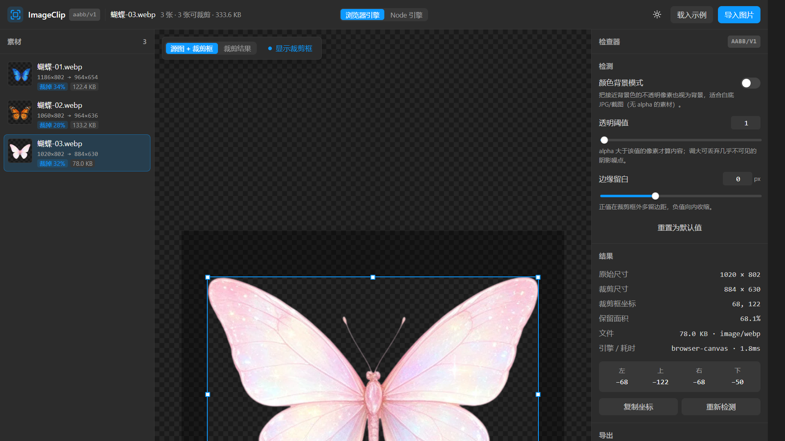
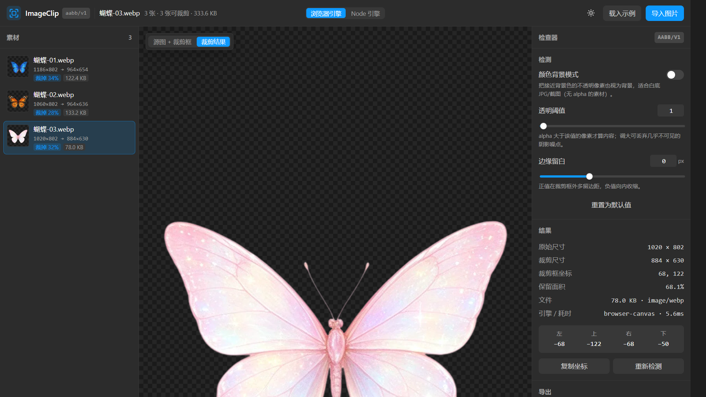
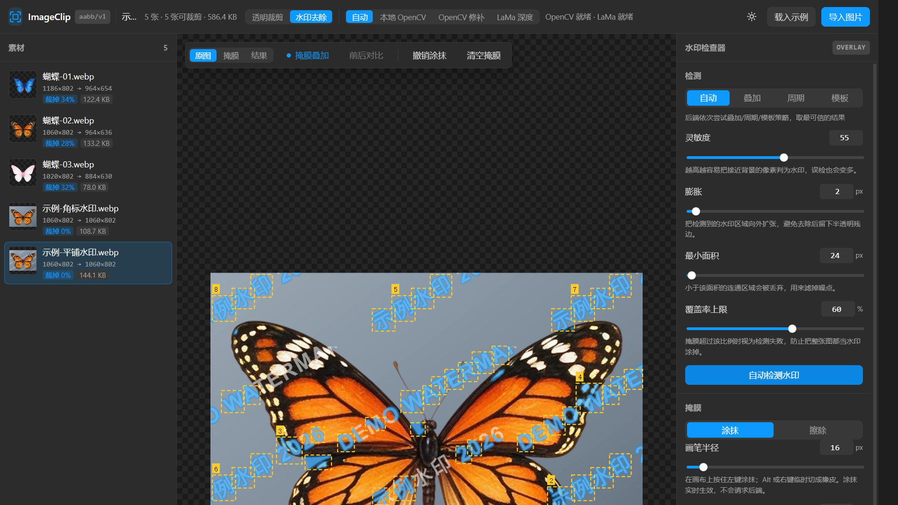
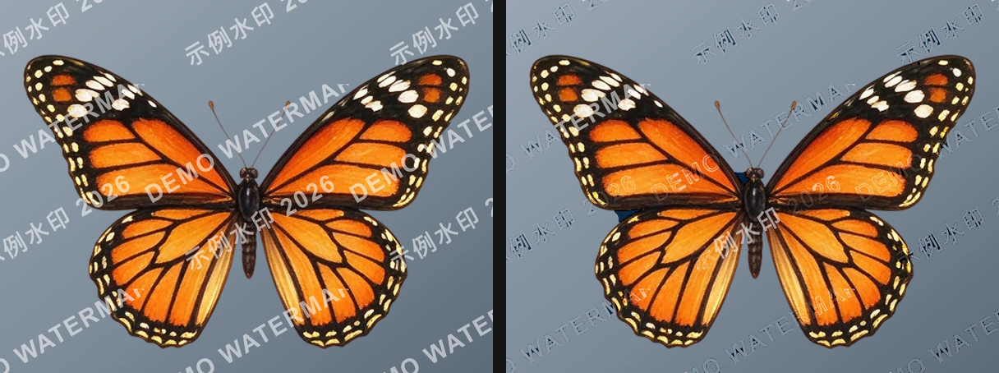

# ImageClip · 透明区域裁剪 + 水印识别去除

> **用户使用说明**（界面 / 参数 / 导出 / 常见问题）→ [`docs/USER_GUIDE.md`](docs/USER_GUIDE.md)

Node + Vue 的图片处理应用。当前版本聚焦一个功能：

> **AABB 自动识别透明区域并切割图片** —— 扫描图片所有不透明像素，算出最小外接矩形
> （axis-aligned bounding box），把四周的透明区域整块切掉。

界面参考 Figma：左侧素材面板、中间棋盘格画布（带选择框 + 8 个手柄 + 尺寸标签，
被裁掉的区域会压暗显示）、右侧检查器、底部状态栏。





---

## 1. 快速开始

```bash
npm install          # 安装 server + web 两端的依赖
npm run dev          # 同时启动 Node API(8786) 和 Vite 前端(5174)
# 打开 http://127.0.0.1:5174
```

生产模式（同一个 Node 进程同时托管 API 和前端产物）：

```bash
npm run build        # 构建 web/dist
npm start            # http://127.0.0.1:8786
```

视频工作区（第 2 章）还需要本机 FFmpeg。它只影响**探测 / 截帧 / 提取音频 / 时间轴缩略图**，
播放本身走浏览器的 `<video>`，没有 FFmpeg 也能看视频。音频工作区（第 8 个工作区）
走 Web Audio，完全不需要 FFmpeg：

```bash
# 把 ffmpeg 与 ffprobe 放到 D:\thirdparty\ffmpeg\bin 即可，无需配置 PATH
curl http://127.0.0.1:8786/api/video/health    # 查看搜索过的路径与可用性
```

打开后点 **载入示例** 会把 `samples/` 里的三张蝴蝶图读进来看效果；也可以直接把图片
拖进画布、`Ctrl+V` 粘贴、或点「导入图片」。

其它命令：

| 命令 | 作用 |
| --- | --- |
| `npm test` | 算法单测 + 服务端接口集成测试（33 项） |
| `npm run verify` | 用 `samples/` 真图跑一遍，打印各阈值下的 AABB 并输出裁剪结果 |
| `npm run dev:web` / `npm run dev:server` | 只启动前端 / 只启动后端 |

---

## 2. 目录结构

```
image-clip/
├─ shared/aabb.js          ★ 核心算法：AABB 检测（零依赖，前后端共用同一份源码）
├─ shared/aabb.test.js       算法单测（19 项，构造像素级 fixture）
├─ shared/bgremove.js      ★ 背景去除：边框主色聚类 + 颜色距离 + 边缘漫水 + 收放边
├─ shared/selection.js     ★ 选区与裁剪数学：套索栅格化、比例矩形、归一化取景
├─ server/
│  ├─ src/imaging.js          sharp 解码 → RGBA → 调 shared/aabb → 裁剪编码
│  ├─ src/ffmpeg.js           FFmpeg 定位 / 探测 / 单帧 / 音频 / 时间轴缩略图
│  ├─ src/library.js          资源库：扫描、上传、子目录、批量改名、缩略图、文件服务
│  ├─ src/video.js            视频路由：probe / filmstrip / frames / audio
│  ├─ src/index.js            Express API + 生产环境静态托管
│  └─ test/api.test.js        真实起 HTTP 服务的集成测试（14 项）
├─ web/
│  ├─ src/components/         9 个工作区的三栏组件（资源库/视频/裁剪/抠图/橡皮擦/水印/音频/像素笔绘）
│  ├─ src/composables/        useAppMode / useLibrary / useVideo / useAudio / useBgRemoval / useCropTool / useEraser / usePixelPaint / useWorkspace
│  ├─ src/lib/imaging.js      浏览器解码 / 检测 / 裁剪导出
│  ├─ src/lib/library.js      资源库与视频 API 客户端（含 XHR 上传进度）
│  ├─ src/lib/audio.js        音频波形 / 频谱 / 裁剪 / PCM16 WAV 编码
│  ├─ src/lib/imageops.js     裁剪 / 合成 → PNG 输出
│  ├─ src/lib/engine.js       浏览器引擎 ↔ Node 引擎的统一契约
│  ├─ src/lib/zip.js          纯 JS 打包 ZIP（批量导出，无第三方依赖）
│  ├─ scripts/vite-runner.mjs 受限环境下的 Vite 启动器（见 §6）
│  └─ vite.noesbuild.config.js 无 esbuild 构建配置（见 §6）
├─ data/library/             资源库磁盘目录（运行时创建，gitignore）
├─ samples/                  示例图片（用户提供的三张蝴蝶，含 alpha）
└─ scripts/verify-samples.mjs 真图回归脚本
```

---

## 3. 算法：AABB 透明区域检测

`shared/aabb.js` 只做一件事，但被严格定义：

```js
detectBounds(rgba, width, height, options) → {
  bounds:  { x, y, width, height },     // 要保留的矩形（像素）
  trimmed: { left, top, right, bottom },// 四边各切掉多少像素
  empty, contentPixels, contentRatio, options
}
```

* **输入是“直通 RGBA”字节**：`width*height*4`，与浏览器 `canvas.getImageData()`、
  Node `sharp().ensureAlpha().raw()` 的输出完全一致。**同一份源码同时跑在两端**，
  这是客户端与服务端结果可以逐像素对齐的根本原因（见 §5 验证）。
* **判定规则**：`alpha > alphaThreshold` 的像素算内容（默认阈值 1，即“非全透明就算内容”）。
  颜色背景模式下追加一条：不透明但 RGB 与 `backgroundColor` 的三通道最大差值 ≤
  `colorTolerance` 的像素也算背景 —— 用于没有 alpha 的白底 JPG/截图。
* **逐像素精确扫描**，不做抽样加速。抽样的“加速版”会漏掉细小的孤立内容、
  甚至把整张图判成空，因此被明确移除（`aabb.test.js` 里有对应的回归用例）。
* `padding` 支持正负：正数向外扩（保留呼吸位），负数向内收（裁掉抗锯齿边缘）。
  结果会被夹取在图片范围内。
* 越界参数会被**收敛**而不是抛错（`alphaThreshold` 夹到 0–255，`padding` 取整…），
  原始参数快照会随结果一起返回，便于复现。

### 阈值怎么选

三张示例图在各阈值下的实测结果（`npm run verify`）：

| 图片 | 阈值 | 原始 | 裁剪后 | 四边去除 (左/上/右/下) | 保留面积 |
| --- | --- | --- | --- | --- | --- |
| 蝴蝶-01.webp | 0/1/8 | 1186×802 | **964×654** | 170 / 114 / 52 / 34 | 66.3% |
| 蝴蝶-01.webp | 16/32 | 1186×802 | 962×654 | 170 / 114 / 54 / 34 | 66.1% |
| 蝴蝶-02.webp | 0/1 | 1060×802 | **964×636** | 48 / 116 / 48 / 50 | 72.1% |
| 蝴蝶-02.webp | 8/16 | 1060×802 | 962×636 | 50 / 116 / 48 / 50 | 72.0% |
| 蝴蝶-03.webp | 0/1 | 1020×802 | **884×630** | 68 / 122 / 68 / 50 | 68.1% |
| 蝴蝶-03.webp | 8/16 | 1020×802 | 882×630 | 70 / 122 / 68 / 50 | 67.9% |

这类素材边缘干净，阈值 0~16 差别只有 1–2 像素；**默认 1** 最保守（不切内容），
若素材带很淡的投影噪点，把「透明阈值」往上调即可丢弃。

---

## 4. HTTP API（Node 侧）

| 方法 | 路径 | 说明 |
| --- | --- | --- |
| GET | `/api/health` | 引擎能力：`sharp` 版本、算法标识、限制、默认参数 |
| GET | `/api/options` | 默认检测参数契约 |
| GET | `/api/samples` | `samples/` 清单（含中文文件名） |
| GET | `/api/samples/:name` | 读取示例原图（带路径穿越防护） |
| POST | `/api/analyze` | 检测 AABB → JSON |
| POST | `/api/crop` | 裁剪 → 图片二进制（`?response=json` 返回 dataURL） |
| POST | `/api/crop/batch` | 批量裁剪 → 逐张结果（单张失败不影响其它） |

请求体支持两种形式：

```bash
# ① 原始二进制 + query 参数
curl -X POST 'http://127.0.0.1:8786/api/crop?alphaThreshold=8&padding=2&format=png' \
     -H 'Content-Type: image/webp' --data-binary @samples/蝴蝶-01.webp \
     -o out.png

# ② JSON + dataURL
curl -X POST http://127.0.0.1:8786/api/analyze \
     -H 'Content-Type: application/json' \
     -d '{"image":"data:image/png;base64,...","options":{"matchColor":true,"colorTolerance":30}}'
```

检测参数（query 或 `options` 均可）：`alphaThreshold`、`padding`、`matchColor`、
`backgroundColor`、`colorTolerance`、`sample`（已无此参数）；输出参数：
`format`（`png`/`webp`/`jpeg`/`avif`/`source`）、`quality`。
二进制响应会带 `X-Image-Clip-Bounds`（base64 JSON）、`X-Image-Clip-Engine`、
`X-Image-Clip-Algorithm` 头。

错误统一为 `{ "error": { "code", "message" } }`：`UNSUPPORTED_FORMAT`(415)、
`EMPTY_CONTENT`(422)、`BAD_FORMAT`(400)、`PAYLOAD_TOO_LARGE`(413)…

---

## 5. 双引擎与一致性验证

界面上可以切换 **浏览器引擎**（`browser-canvas`，本地即时、不上传图片）和
**Node 引擎**（`node-sharp`，POST 到服务端）。两者调用同一个 `shared/aabb.js`，
所以在同一张图上会给出**完全相同**的 AABB —— 实测（蝴蝶-03，阈值 1）：

```
浏览器引擎: 1020×802 → 884×630 @ (68, 122)   5.6ms
Node 引擎 : 1020×802 → 884×630 @ (68, 122)   45ms
```

如果 Node 服务没启动，切到 Node 引擎会自动回退到浏览器引擎并在结果里标注，
不会让界面卡在错误状态。

### 已验证的行为（不是"应该能跑"）

* `npm test` —— **92 项全绿**：
  * 算法 19 项（裁剪）：四周边距、单像素角落、不规则形状、整图透明、阈值边界（`>` 与 `>=` 的区别）、
    正负 padding 夹取、颜色背景模式及容差、非法缓冲区报错、参数收敛。
  * 掩膜 16 项 + 指标 6 项 + 反混合 7 项（水印）：腐蚀/膨胀/开闭/羽化、连通域、RLE 编解码、
    PSNR/SSIM、不透明度估计与还原。
  * 服务端 26 项：裁剪 14 项（真实 HTTP 服务上的检测/裁剪/批量/多格式输出/错误码，以及
    **CMYK JPEG**、**调色板 PNG** 的规范化路径）+ 水印 12 项（检测精度、反混合还原、
    三种不透明度、显式掩膜、掩膜尺寸对齐、空掩膜报错、干净图不误检、模板定位、LaMa 回退与真实推理）。
  * 前端 18 项：ZIP 打包 3 项 + 水印掩膜算法与 API 载荷 15 项。
* `npm run verify` —— 真实示例图跑通并输出裁剪结果到 `probe-out/`。
* `npm run verify:watermark` —— 合成水印的量化报告（IoU/精确率/召回率 + PSNR/SSIM），
  结果图输出到 `probe-out/watermark/`。
* 浏览器端到端（Chrome 155 + Playwright 驱动真实点击）：
  * 裁剪：导入三张示例 → 浏览器引擎得出 884×630 @(68,122) → 切 Node 引擎得到同一结果 →
    切「裁剪结果」视图 → 状态栏显示 `Node 服务端已连接 · sharp 0.34.5`。
  * 水印：切「水印去除」→ 载入示例 → 选 `示例-平铺水印.webp` → 自动检测水印
    （覆盖 11.69% / 置信度 100% / 64 个候选区域）→ 执行去除（**unblend · 431ms**）→
    切「结果」视图拿到 1.17 MB 输出，下载与打包按钮可用。

---

## 6. 水印识别与去除

界面上切到 **水印去除** 模式即可：检测 → 掩膜（自动/手涂）→ 去除 → 导出。
这一节说明它到底怎么工作、数字是多少、以及**哪些情况它做不了**。

### 6.1 关键结论：半透明水印要"反混合"，不要"修补"

水印是叠加：`I = α·W + (1−α)·B`。要还原底图，应当**解方程**：

```
B = (I − α·W) / (1 − α)
```

而不是把掩膜区域"涂掉重画"。实测（合成 α=0.35 的白色水印，640×480）：

| 处理方式 | 掩膜区 PSNR | 掩膜区 SSIM | 说明 |
| --- | --- | --- | --- |
| 带水印（基线） | 19.65 dB | — | — |
| OpenCV 修补（Telea） | 22.9 dB | 偏低 | 把内容糊掉，纹理丢失 |
| LaMa 深度修补 | 略好于 Telea | — | 结构合理但仍是"编内容" |
| **反混合（本项目）** | **57.1 dB** | **0.9998** | 数值上几乎无损，α 估得 0.351（真值 0.35） |

所以 `engine: 'auto'` 的优先级是 **unblend → lama（装了模型）→ opencv**，
只有"估不出可信的 α"（例如水印是不透明实心块）才会退到修补。

### 6.2 检测：α-map + 形态学背景 + 多重判据

朴素做法（Otsu / 高斯差分）在真实图上召回率只有 0.45 左右，原因是**亮度差会随背景明暗变化，
而不透明度 α 不变**。所以检测的核心是逐像素估计

```
α ≈ (I − B) / (W − B)        W=255（亮水印）或 0（暗水印）
```

其中背景 `B` 用**形态学开/闭运算**估计（结构元宽度取 `min(w,h)/22`，比笔画宽），
而不是高斯模糊——模糊尺度接近笔画间距时会在笔画间隙留下负向鬼影。

对每个连通域按 8 个特征打分：α 一致性、α 合理性（0.08~0.7）、饱和度、重复性、
边缘锐度、面积、细长比、靠边程度。另外三条**硬门槛**用来压误检：

1. **透明度门限**：alpha < 24 的像素不参与（透明区域没有内容，其边界还会产生强伪边缘）。
2. **α 聚类一致性**：同一次叠加只有一个 α，各连通域 α 离散度 > 0.05 直接判"不像同一次叠加"。
3. **重复性支持**（默认开）：至少两个"有分量"的同尺寸实例，或整体覆盖 ≥3%。
   真实的平铺水印满足它；而插画里的装饰高光/纹理脊线往往是一次性小块。
   需要检测**单个角标 logo** 时，请用「模板匹配 / 框选 / 画笔」，或把 `requireRepeat` 关掉。

检测完成后，画布上会把你**检出哪些位置**直接标出来：每个候选区域画成琥珀色虚线框，
面积最大的 8 个带编号；这些框不受「掩膜叠加」开关影响（它们是检测结果，不是掩膜），
画布左下角同时显示「检出 N 处 · 覆盖 x%」，右侧检查器的「结果」区给出方法/置信度/候选数/耗时。



实测（同一套参数）：

| 输入 | 覆盖率 | 置信度 | 说明 |
| --- | --- | --- | --- |
| 合成平铺水印（4 条 α=0.35） | 5.77% | — | **IoU 1.000 / 精确 1.000 / 召回 1.000**，α 估 0.351 |
| `示例-平铺水印.webp` | 11.69% | 100% | α 估 0.553（真值 0.55） |
| `蝴蝶-01/02/03.webp`（无 watermark） | **0.00%** | 0 | 三张都不误检 |

### 6.3 三个引擎



> 右侧仍有**极淡的残边**：掩膜是二值的，笔画抗锯齿边缘未被完全覆盖（见 6.4）——
> 调大「羽化」并略微「膨胀」，或把灵敏度调高让掩膜包住过渡像素，都能进一步压下去。

| 引擎 | 适用 | 实测耗时（1060×802） |
| --- | --- | --- |
| `unblend` | 半透明水印（文字/平铺/角标），**首选** | ~0.4s（纯 JS） |
| `opencv` | 不透明小块、彩色标记（Telea 修补） | ~0.5s |
| `lama` | 大面积缺失、不透明大标记（需要模型） | ~3s / 512 窗口，模型加载 ~19s（常驻缓存） |

LaMa 为**固定 512×512** 输入，所以按原生分辨率做重叠窗口切片（`planPatches`），
只把掩膜内的像素回贴（掩膜外**一像素不改**，有 `changedOutsideMask` 断言守着）。
本机 RTX 3060 上 DirectML 不可用（`MatMul ... MPAUTHOR` 报错），已固定 CPU EP。

### 6.4 语义门控：用离线小模型把检测限制在文字区域内（可选，默认关闭）

纯统计检测有个绕不过去的弱点：**它没有"水印"这个概念**。用户实测样例
`samples/蝴蝶-豆包AI水印.jpg`（2720×1520，20 只蝴蝶排成网格，只有右下角一段
「豆包AI生成」浅灰角标）把这个问题暴露得很彻底：

| 现象 | 实测 |
|---|---|
| 检出的掩膜里真正落在水印上的比例 | **0.4%** |
| 落在蝴蝶（画面内容）上的比例 | **99.6%**（101 个连通域散布全图） |
| 周期性路径对同一张图的判定 | **22.4%** 覆盖，把蝴蝶网格当成"平铺水印" |

原因不是参数没调好：蝴蝶网格同时满足「重复出现」「尺寸一致」「覆盖率合理」，
而亮极性在近白背景上把浅色蝴蝶读成 α≈0.48~0.55 的叠加物。

**解法**：绝大多数可见水印是**文字**，所以引入一个 4.5MB 的离线文本检测模型
（PP-OCRv4 det / DBNet，纯 ONNX，运行期零 Python 依赖）先回答"图里哪儿是文字"，
把水印检测限制在这些区域内 —— 非文字内容从结构上就不可能再被当成水印；
文字区域只当**种子**，像素级掩膜仍由本地 α-map 精修。

```bash
npm run model:watermark    # 下载文本检测模型（4.5MB，走 hf-mirror 镜像）
# 开启门控（接口层，默认关闭）：
curl -X POST 'http://127.0.0.1:8786/api/watermark/detect?textGate=1' --data-binary @samples/蝴蝶-豆包AI水印.jpg
npm test                   # 模型存在时会跑 server/test/text-gate.test.js，缺模型自动跳过
```

实测（同一张图）：

| 配置 | 覆盖 | 掩膜落在文字框内 | 文字框被覆盖 |
|---|---|---|---|
| 默认（门控关） | 1.887% | 0.4% | 0.8% |
| `method=model` / `textGate=1` | **0.224%** | **100%** | **24.1%** |

检出之后还有一遍**门控内的召回恢复**（`recoverInsideGate`）：第一遍走常规判据（精度高、
召回低，只覆盖文字框 1.4%），随后在"包含第一遍命中像素的整个文本框"内，用更低阈值 +
关掉支持性判据再跑一遍，两遍取并集且始终与门控求交。

⚠️ 恢复遍**必须用标准清理强度**（与第一遍一致）。试过 `cleanupLevel:'light'`：笔画召回能从
4.2% 提到 25.9%，但它会放行大片近白噪声 —— 掩膜/外接框填充率从 **0.23 涨到 0.56**，
界面上就是"一整块糊过去"，用户实测直接反馈**"范围过大"**。现在默认标准清理
（用户图：掩膜 3551px、填充率 0.23、100% 落在文字框内、浅灰笔画召回 32%）。
要更高召回应该另做一遍**全分辨率**的区域内恢复（细笔画在降采样图上只剩 1~2px）。
文本框还会**沿文字行方向外扩 0.6×框宽** —— 文本检测器常常只在一行字的局部着火
（实测只找到「AI生成」），而水印是整行「豆包AI生成」。

三张无水印素材在门控下仍为 0.000%；`示例-平铺水印` 6.7%（其文字区域被门控放行）。

#### 第二个提议源：YOLOv5 水印框模型（图形类水印 / 更紧的框）

文本门控只认"文字"，覆盖不到 logo/图标/印章这类图形水印。所以再接一个**YOLOv5 水印
检测器**（`Eugeoter/yolov5-watermark-detection`，单类 `watermark`）作为第二个提议源：
它直接给出水印**边界框**，同样是"模型给区域、本地 α-map 给像素"。

实测（同一批样例）：

| 样例 | YOLO 给出的框 | 文本门控 | YOLO 门控 |
|---|---|---|---|
| `蝴蝶-豆包AI水印.jpg` | **1 个，247×59 @(2446,1435)**（正压在水印上） | 覆盖 0.224%，精度 100% | 覆盖 **0.242%**，精度 100%，文字框覆盖 **25.9%** |
| 蝴蝶-01/02/03（无水印） | **0 个框** | 0% | 0% |
| `示例-平铺水印` | 2 个框（只盖住两块） | 6.700% | 0.748%（**两个源并集才是 6.700%**） |

用法：`method=yolo`（只用框模型）、`textGate=1&yoloGate=1`（两个源**并集**，
平铺水印这种需要它）。

模型获取是**两步**（权重只有 PyTorch 格式，须构建期导出一次）：

```bash
node scripts/download-wm-model.mjs --yolov5   # 权重 165MB + YOLOv5 v7.0 源码（codeload）
# 一次性导出环境（本机 anaconda python 建 venv；numpy/opencv 必须钉 1.x/4.10 以匹配 torch 2.4）
D:\ProgramData\anaconda3\python.exe -m venv models/venv
models/venv/Scripts/python.exe -m pip install -i https://pypi.tuna.tsinghua.edu.cn/simple \
  "torch==2.4.0" "torchvision==0.19.0" onnx "numpy<2" "opencv-python-headless<4.11" "setuptools<80" \
  pandas requests ipython matplotlib seaborn scipy tqdm psutil thop
npm run model:export:yolov5                    # → models/watermark-yolov5.onnx
```

⚠️ 两点注意：
* 导出产物 **329MB**（模型是 YOLOv5x 量级，86M 参数 fp32），比文本模型大两个数量级；
  只想要文字水印的话不必装它。CPU 单图推理实测 **0.5~1.0s**。
* 该模型的架构来自 **YOLOv5（AGPL-3.0）**，对外分发前请确认授权合规（见 THIRD_PARTY_NOTICES）。

**当前限制（下一步）**：
* 门控覆盖文字框约 24%（这类低对比空心字对文本检测器本身就是难的），
  所以检出是"对的但不满"；继续提召回要在**内容边界**上做掩膜精修。
* 这段水印横跨蝴蝶翅膀：掩膜在翅膀上的那部分会连带被替换/修补，
  实测会糊掉一小块（去除质量，不影响检测精度）。
  纯统计路径下这个问题同样存在，与门控无关。
* 请求门控时若**图中没有文字**，直接判"无文字水印"（不会退回无门控检测，
  否则画面内容的误检又会回来）。
* 直接改全局清理强度（`cleanupLevel:'light'`）能提召回但会打坏 α 一致性聚类
  （`示例-平铺水印` 掉到 0%），所以只在恢复遍里用。

### 6.5 已知边界（请当成设计事实，而不是"以后可能修"）

* **自动检测针对"细结构半透明水印"**：文字、细线 logo、平铺标记。笔画宽度超过
  `min(w,h)/22`（1000px 图上约 45px）的粗大色块不会被开运算当成"可移除的结构"，
  需要走**模板匹配 / 框选 / 画笔**。
* **单个孤立角标**默认不会被自动识别（见 6.2 的重复性门槛）——请用模板或画笔，
  这两条路径是确定性的。
* **掩膜边界是硬的**：α 只在掩膜内求解，笔画边缘的抗锯齿像素若有残留会留下淡边；
  调大「羽化」+ 略微「膨胀」可以缓解，代价是边缘略糊。
* 检测是**单图无监督**的：插画类素材（大量重复装饰高光）在关掉重复性门槛后仍可能误检，
  这是方法本身的歧义，不是参数没调好；打开 `textGate` 可以从结构上消掉这类误检。
* **图形类（非文字）水印**不在文本门控覆盖范围内。备选路线是
  `Eugeoter/yolov5-watermark-detection`（165MB YOLOv5，输出水印边界框）：
  `node scripts/download-wm-model.mjs --yolov5` 下权重与源码，再用
  `scripts/export-wm-yolov5.py` 在构建机导出 ONNX（本机 torch 2.4.0+cpu 已验证可导出）。
* `LaMa` 未安装时 `auto` 会回退 `opencv` 并在结果里给出 `reason`，不会失败。

### 6.6 相关命令与接口

```bash
npm run model:lama        # 下载 LaMa 权重（198MB，断点续传，可用 hf-mirror）
npm run samples:demo      # 生成带水印的演示素材（samples/示例-*.webp）
npm run verify:watermark  # 量化报告 + probe-out/watermark/ 结果图
```

```bash
# 健康检查（OpenCV/LaMa 是否就绪）
curl http://127.0.0.1:8786/api/watermark/health

# 检测：返回 mask.dataUrl（灰度 PNG）、rle、boxes、coverage、confidence、estimatedAlpha、diagnostics
curl -X POST 'http://127.0.0.1:8786/api/watermark/detect?method=auto&sensitivity=55' \
     -H 'Content-Type: image/png' --data-binary @samples/示例-平铺水印.webp

# 去除：JSON 体（image + mask）+ ?response=json 拿元信息；不传 mask 时服务端自己检测
curl -X POST 'http://127.0.0.1:8786/api/watermark/remove?engine=auto&response=json' \
     -H 'Content-Type: application/json' \
     -d '{"image":"data:image/png;base64,...","mask":"data:image/png;base64,..."}'
```

`remove` 查询参数：`engine`(auto/unblend/opencv/lama)、`watermarkColor`(auto/white/black/#rrggbb)、
`alphaHint`、`polarity`(auto/bright/dark)、`inpaintRadius`、`dilate`、`feather`、`format`、`quality`、`integrity`。

> 前端在检测后会把 `estimatedAlpha` 与 `polarity` 原样回传给 `remove`。
> 这不是可选项：反混合的 α 是"估计"出来的，细笔画掩膜上单靠边界能量并不可靠
> （实测同一水印：带先验 α=0.553，不带先验 α=0.02 → 会被误判成"不能反混合"而改用慢 30 倍的 LaMa）。

---

## 7. 受限环境（沙箱 / 无子进程 CI）

Vite 默认依赖 esbuild，而 esbuild 每次都会 **spawn 一个原生子进程**；在禁止派生进程的
环境里会直接 `EPERM`。本仓库为此提供了两条不碰 esbuild 的等价链路（正常环境仍然用
标准的 `npm run dev` / `npm run build`）：

```bash
npm --workspace web run build:restricted   # = node scripts/vite-runner.mjs build --configLoader runner --config vite.noesbuild.config.js
npm --workspace web run dev:restricted
```

它们做了三件事：

1. `--configLoader runner`：配置不再用 esbuild 打包，改用原生运行时加载。
2. `vite.noesbuild.config.js`：关掉 esbuild（`esbuild: false`）、关掉压缩与语法降级
   （`target: esnext`、`minify: false`），并用一个小插件提前替换掉
   `process.env.NODE_ENV` / `__VUE_*__` 这些本来由 esbuild 负责的 define 常量
   （Vite 的 `vite:define` 插件只在源码命中这些标识符时才调 esbuild）。
3. `scripts/vite-runner.mjs`：Vite 在 Windows 上会执行 `exec('net use')` 探测网络驱动器，
   该调用点没有 try/catch，spawn 失败会直接崩掉进程；启动器只把这一条命令替换成
   “没有网络映射盘”的空结果。注意补丁必须用 CJS `require` 并在 **任何 ESM 命名导入之前**
   完成，否则 Node 已经建好 `node:child_process` 的命名导出快照，补丁不生效。

另外仓库根 `.npmrc` 里设了 `ignore-scripts=true`：唯一带 install script 的依赖是
`sharp`，其脚本只是校验已经作为可选依赖下载好的预编译二进制，跳过它可以保证在
限制子进程的环境里 `npm install` 也能成功（`sharp` 本身功能不受影响，已实测）。
如果你的环境不限制子进程，删掉这一行即可。

如果在受限环境里 `npm install` 报用户级缓存目录不可写：

```bash
npm install --cache .npm-cache     # npm 不接受 .npmrc 里的相对 cache 路径，需显式指定
```

---

## 8. 已知边界

* 检测基于 **alpha 通道**（和可选的背景色匹配）。纯白底 JPG 需要打开「颜色背景模式」，
  容差要自己调；浅色主体贴白底时容易误伤，这类素材更适合先用抠图工具处理。
* 不做 EXIF 自动旋转：浏览器 `createImageBitmap` 默认与 `sharp` 一样按原始像素方向处理，
  两端一致；带旋转信息的手机照片需要在导入前自行矫正。
* 单张上限：64MB / 6400 万像素（两端都有校验，服务端返回 413）。
* 批量导出 ZIP 使用 store 模式（不二次压缩）—— 图片本身已是压缩格式，
  这样还能省掉一个依赖。
* 视频的探测/截帧/音频/时间轴缩略图依赖本机 FFmpeg；没有 FFmpeg 时视频工作区
  只保留播放与手动标记。
* 背景去除是**颜色算法**，不做语义分割：背景纹理复杂、前景与背景同色时需要靠
  取色器、容差与套索配合。
* 资源库单文件上限 2GB、最多 20000 个文件（`IMAGE_CLIP_MAX_UPLOAD_BYTES` /
  `IMAGE_CLIP_LIBRARY_MAX_FILES` 可调）。

---

## 9. 界面快捷键

| 操作 | 说明 |
| --- | --- |
| `1`~`9` | 切换工作区（资源库 / 视频 / 透明裁剪 / 图片裁剪 / 背景去除 / 橡皮擦 / 水印 / 音频 / 像素笔绘） |
| 拖放 / `Ctrl+V` | 导入；资源库、视频与音频模式下直接上传到服务端 |
| `Ctrl+O` | 打开文件选择框 |
| 滚轮 | 以光标为中心缩放 |
| 拖拽画布 | 平移（背景去除的「平移」工具下） |
| `0` | 适应窗口 |
| `R` | 源图 ↔ 裁剪结果（透明裁剪 / 水印） |
| `Delete` / `Backspace` | 移除当前素材（资源库中为删除选中项） |
| `[` / `]` | 调小 / 调大笔刷（水印、橡皮擦） |
| `Ctrl+Z` / `Ctrl+Shift+Z` | 橡皮擦撤销 / 重做 |
| `←` / `→` | 资源库预览中前后翻页；音频工作区微调播放头（`Shift` 为 5 秒） |
| `空格` | 音频工作区播放 / 暂停 |

画布左下角会实时显示光标处的图像坐标与 RGBA（`A 0` 高亮），
调阈值时可以直接看着 alpha 判断边界。

## 7. 大模型接入（本地 DeepSeek 视觉模型 + 工具调用）

### 7.1 架构：模型只做决策，像素操作全在本机

```
浏览器 ──SSE──> Node 服务 ──OpenAI 兼容 HTTP──> 模型端点
                    │                           ├─ 本地 DeepSeek-VL2 侧车（本项目自带，127.0.0.1:11500）
                    │                           ├─ 本机 Ollama（127.0.0.1:11434）
                    └─ 工具执行（本机）          └─ 云端 OpenAI 兼容（⚠️图片外发，需显式切换）
                         detect_watermark / remove_watermark / crop_transparent / resize / convert / save
```

**关键取舍**：不让模型生成像素。模型负责"看懂意图 + 决定调哪个工具 + 读出参数"，
真正的检测/去除/裁剪/缩放都在本地算法或本地 ONNX 模型里跑。好处是：
- 图片**不出本机**（默认端点都是 127.0.0.1）；
- 精确度由本地算法保证，不受模型能力限制；
- 换模型只改 `baseUrl`+`model`，其余代码零改动。

### 7.2 四个能力对应的实现

| 需求 | 实现 |
|---|---|
| 大模型接入入口 | `server/src/llm/`（providers/client/tools/agent/routes）+ 顶栏「AI 对话」按钮 → `ChatDrawer.vue` |
| 大模型切换 | provider 注册表：`GET/PUT /api/llm/providers`、`POST /api/llm/providers/:id/activate`；设置存 `data/llm.json`（gitignore），API key 只写不读回 |
| 水印识别与去除 | 模型调用 `detect_watermark`（method=model/yolo）→ `remove_watermark`（传 maskId）；都是本地真跑 |
| 任意图片操作对话 | 工具集：crop_transparent / resize_image / convert_image / save_artifact / image_info / list_assets；SSE 流式展示工具轨迹 |

模型能力不够时的兜底：**提示式工具调用** —— 不支持原生 function calling 的模型
（如 DeepSeek-VL2-tiny、很多 Ollama 模型）只要按系统提示输出
`{"tool": "...", "arguments": {...}}`，agent 就会解析并执行（见 `parsePromptedToolCall`）。

### 7.3 本地 DeepSeek 视觉模型（本项目的默认端点）

```bash
node scripts/download-deepseek-vl.mjs     # 下载 deepseek-vl2-tiny（6.28GB，断点续传，modelscope→hf-mirror 双源）
npm run llm:serve                          # 起 OpenAI 兼容侧车（127.0.0.1:11500）
```

- 权重放 `models/deepseek-vl2-tiny/`（已 gitignore，不入库）；**CPU 加载约 12~20 秒**。
- 选型说明：`deepseek-vl-1.3b` 在镜像上 401 取不到；`vl-7b-chat`/`vl2-small` 14GB+；
  **`deepseek-vl2-tiny`（6.28GB）是能拿到的最小 DeepSeek VL 对话模型**。
- ⚠️ **CPU 推理很慢**：单次带图回答实测数分钟级（3B MoE + 视觉编码器）。适合"离线、不着急"的场景；
  要交互流畅请用本机 Ollama 的小视觉模型（如 `qwen2.5vl:3b`）并把 provider 切过去。
- 装机时踩平的兼容坑（都写在 `scripts/llm-sidecar-deepseek-vl.py` 里）：
  1. `sentencepiece 0.2.2` 在本机 Python 3.11 上 `import` 直接**访问违例崩溃**（0xC0000005）→ 钉 `0.2.0`；
  2. `siglip_vit.Attention.forward` **硬编码** `from xformers.ops import ...`（非条件导入），
     CPU 没装 xformers → 注入 `F.scaled_dot_product_attention` 的等价 shim；
  3. VL2 代码依赖 `transformers<4.47` 的旧内部 API → 钉 `transformers==4.40.2 / tokenizers==0.19.1 / huggingface-hub==0.23.5`。

### 7.4 测试（不依赖真实权重）

`server/test/llm.test.js` + `server/test/mock-llm.js`：用一个按脚本回复的
**mock OpenAI 服务**跑通完整闭环 —— 入口 → 切换 → 上传 → 模型发（原生/提示式）工具调用 →
本地真跑检测与去除 → artifact 回取 → 多轮历史。所以 CI 不需要 6.28GB 权重或 GPU。

### 7.5 隐私边界

- 默认提供方全部指向 `127.0.0.1`；**只有显式切到"云端"提供方时图片才会离开本机**（UI 上标 ⚠️云端）。
- 对话 artifact 落在 `data/artifacts/`（gitignore，本地磁盘），可用 `save_artifact` 导出到 `data/exports/`。

### 6.7 GPU（DirectML）默认开启

本机有 RTX 3060 Laptop（6GB 显存）、驱动 616.92、CUDA Toolkit 12.2。ONNX 推理默认走
**DirectML**（onnxruntime-node 自带 `dml` 后端，**无需额外下载**），失败自动回退 CPU：

| 项目 | CPU | DirectML | 说明 |
|---|---|---|---|
| YOLO 水印框推理 | 596ms（中位） | **54ms（11×）** | 受控 A/B 各 3 次 |
| 门控检测端到端 | 8019ms | 7297ms | 模型只占一小部分，大头是 α-map |
| 纯统计检测端到端 | 3172ms | 3095ms | 无模型参与，符合预期 |

- 环境变量 `ORT_PROVIDERS` 可强制（`cpu` / `dml,cpu`）；默认 `dml,cpu`。
- **LaMa 仍是 CPU 默认**：实测 DirectML 在 LaMa 的 FFC/RTTN MatMul 上会报
  `E_INVALIDARG`（见 server/src/lama.js 文件头）；需要试验时设 `IMAGE_CLIP_LAMA_EP=dml`。
- 端到端提升有限的根因：α-map / 形态学在 OpenCV.js(WASM/CPU) 里，要更快得换 WebGL/WebGPU
  或把检测也搬到 ONNX —— 属于另一项工作。
- 大模型（DeepSeek-VL2）目前仍跑 CPU：venv 里的 torch 是 `+cpu` 轮子（当初为导出 ONNX 装的）。
  上 GPU 需换 `torch+cu121`（2.27GB）并解决显存：权重 6.4GB > 6GB 显存，需要 4-bit 量化或
  offload；换 2B 级视觉模型（如 Qwen2-VL-2B）则可直接放显存。

---

## 10. 多工作区：资源库 / 视频 / 抠图 / 裁剪 / 橡皮擦 / 音频 / 像素笔绘

顶栏第二行是工作区切换，键盘 `1`~`9` 依次对应：

| 键 | 工作区 | 能力 |
| --- | --- | --- |
| `1` | 资源库 | `data/library` 的统一管理：子目录、上传、批量改名、移动/删除、预览、一键转入编辑 |
| `2` | 视频 | 播放器 + 完整时间轴（胶片缩略图 / 刻度 / 标记）、关键帧截取、音频提取 |
| `3` | 透明裁剪 | 原有 AABB 功能（§3） |
| `4` | 图片裁剪 | 常用比例、自定义尺寸与尺寸预设、针对一组素材的批量裁剪 |
| `5` | 背景去除 | 自动识别任意底色 + 取色器 + 套索选区 |
| `6` | 橡皮擦 | 硬度/强度可调、擦除与还原两种模式、撤销/重做 |
| `7` | 水印去除 | 原有水印功能（§6） |
| `8` | 音频 | 频谱 + 波形时间轴，框选区间裁剪并保存 PCM16 WAV |
| `9` | 像素笔绘 | 像素级画笔/橡皮/吸管/平移，像素网格与脏矩形撤销，导出 PNG 或生成新素材 |

九个工作区共用同一个三栏骨架：左侧「资源 / 素材」，中间「舞台」，右侧「参数面板」。
图片类工作区共享同一份素材列表（`useWorkspace`），所以「资源库 → 转入编辑 → 换工具」
不需要重新导入。

### 10.1 FFmpeg 定位与安装

`server/src/ffmpeg.js` 按下面顺序找二进制，第一个可用的胜出：

1. 环境变量 `FFMPEG_PATH` / `FFPROBE_PATH`（单文件），或 `FFMPEG_DIR`（目录）；
2. `<repo>/models/ffmpeg/bin`；
3. **`D:\thirdparty\ffmpeg\bin`**（本项目的约定目录，三方软件统一放这里）；
4. `C:\ffmpeg\bin`、`C:\Program Files\ffmpeg\bin`、`C:\ProgramData\chocolatey\bin`；
5. 最后回退到 PATH 里的 `ffmpeg` / `ffprobe`。

安装就是把 [gyan.dev](https://www.gyan.dev/ffmpeg/builds/) 的 essentials 压缩包解压，
保证 `D:\thirdparty\ffmpeg\bin\ffmpeg.exe` 与 `bin\ffprobe.exe` 同时存在。
`GET /api/video/health` 会返回 `available`、版本号、实际路径，以及**所有搜索过的路径**，
排查时不用猜。

失败时的行为是降级而不是报错：视频仍能播放、能打标记，只是截帧/音频/时间轴缩略图
会返回明确的错误码（`FFMPEG_NOT_FOUND` 等）。

### 10.2 资源库

资源库不是虚拟列表，磁盘目录就是唯一事实来源：

```
data/library/                    ← IMAGE_CLIP_LIBRARY_DIR 可覆盖
├─ 关键帧/<视频名>/frame-0001.png   ← 视频截帧默认落点
├─ 音频/<视频名>.mp3              ← 音频提取默认落点
├─ 导出/                         ← 图片工具「保存到资源库」的默认落点
└─ …用户自建子目录
data/library-thumbs/             ← 缩略图缓存（按 路径+mtime 命名）
data/cache/filmstrip/            ← 时间轴缩略图缓存（按 路径+mtime+数量+宽度 哈希）
```

* **上传**：`POST /api/library/upload`，流式落盘到 `.part-` 临时文件，完成后原子改名，
  列表里不会出现半截文件。文件名和目录放在 `X-File-Name` / `X-File-Dir` 头里
  （前端已 `encodeURIComponent`，所以中文名不会乱码）。默认上限 2GB
  （`IMAGE_CLIP_MAX_UPLOAD_BYTES`）。
* **路径安全**：所有相对路径都在服务端 `resolve()` 里校验，拒绝 `..`、绝对路径和越界，
  前端拿到的永远是相对资源库根目录的 POSIX 路径。
* **批量改名**：`buildBatchNames(list, config)` 是纯函数，支持编号（起始值/步长/补零）、
  查找替换、前后缀、大小写；UI 先预览新旧对照再提交，冲突与非法字符在后端返回逐条结果。
* **预览**：`previewPath` + 左右方向键在**当前筛选结果**里前后翻页，不跳出当前目录/搜索。
* **一键转入编辑**：把资源库文件取成 Blob → `workspace.addFiles` → 切到对应的图片工作区；
  批量选中多张时可以直接进入裁剪工作区做批量裁剪。
* **文件服务**：`GET /api/library/file` 走 `res.sendFile`，因此支持 Range 请求，
  `<video>` 可以拖动进度条、只加载需要的片段。

### 10.3 视频工作区

* **探测**：`ffprobe` 给出时长、宽高、帧率、编码、码率、是否有音轨。
* **完整时间轴**：服务端用 FFmpeg 均匀抽 `count` 帧、缩到 `width` 拼成胶片条；
  前端按 `flex:1` 平铺，叠加自适应刻度（0.5s~600s 里挑一个让标签 ≤12 个的步长）、
  手动标记（红竖线）和播放头。拖动时间轴会持续 seek，按下即暂停。
* **三种截帧模式**（`POST /api/video/frames`）：
  * `interval`：固定间隔（0.05s~3600s）；
  * `count`：在整段视频上均匀取 N 帧；
  * `times`：只截时间轴上手动打的点。

  单次最多 **120 帧**（`MAX_FRAMES`），输出默认 `关键帧/<视频名>/`，
  支持 png/jpg、输出宽度、文件名前缀。返回 `requested/extracted/failed/entries/folder/elapsedMs`，
  单帧失败不影响其它帧。
* **提取音频**（`POST /api/video/audio`）：mp3 / m4a / wav / flac，默认落到 `音频/`；
  没有音轨时直接返回 422 `AUDIO_MISSING`，前端按钮同步禁用。
* 播放过程中的真实位置由 `<video>` 的 `timeupdate` 维护，`state.currentTime` 只在
  `seekTo()` 时写入 —— 这样播放头不会因为状态回写而抖动。

### 10.4 背景去除（`shared/bgremove.js`）

纯算法、零依赖，浏览器与 Node 都能跑同一份代码：

1. **边框取色**：统计画面四周 `ring=2px` 环带里的颜色，按每通道 4bit 量化后聚类，
   得到 1~3 个候选背景色（纯色、双色渐变、简单扎染底都能覆盖）；
2. **颜色距离 + 连通性**：加权 RGB 距离（0.299R²+0.587G²+0.114B²）判定“像不像背景”，
   默认从四条边做 4 邻域漫水，只抠**与边缘连通**的区域 —— 人物身上的白衣服不会被误抠；
   需要“全图同色都去掉”时可以关掉连通性；
3. **收放边**：先按 `erode` 收缩（切掉底色描边），再按 `feather` 羽化，让 alpha 平滑过渡；
   勾选「反混合」时按 `B = (I − α·C)/(1 − α)` 把半透明边缘的底色污染一起解掉。

参数默认值在 `BG_DEFAULTS`：容差 32、连通开、羽化 2px、收缩 0、`maxColors 3`。
界面上的取色器可以直接在图上点任意位置取色（存原图坐标，预览缩放不影响精度）。

**套索**（`shared/selection.js`）用扫描线多边形栅格化（按像素中心判定，边界不吃像素），
选区模式三种：`inside` 只处理选区内、`outside` 只处理选区外、`all` 忽略套索。
套索点存的是**原图坐标**，所以「1600px 预览上画的套索 → 原分辨率应用」结果一致。

预览与导出分离：预览最长边 1600px 保证交互跟手，「按原图分辨率应用」时才用原图重算，
避免大图每次都跑全量算法。

### 10.5 图片裁剪（`shared/selection.js` + `useCropTool`）

* 内置比例：1:1、4:3、3:2、16:9、9:16、4:5、3:4、2:3，另有自由比例；
* 裁剪框可输入 X/Y/宽/高精确值，滚轮缩放、拖动平移，8 个手柄缩放（锁比例时按角缩放）；
* **输出尺寸**：`natural`（裁剪框原尺寸）或 `resize`（指定宽/高，另一边按比例推算，
  上限 20000px 收敛）；内置常用尺寸（头像 512、1080p、4K 等）并可**保存自定义尺寸**，
  存在 localStorage，跨会话可用；
* **批量裁剪**：以「归一化矩形」描述取景（`rectFromNormalized`），套到**每一张尺寸不同的图**
  上都保持同样的构图。典型用法：选中视频批量截出来的关键帧 → 一次裁剪全部；
  结果可写回资源库（`裁剪结果/`）或打包 ZIP 下载，面板里有逐张进度。

### 10.6 橡皮擦（`useEraser`）

* 每个素材一块工作画布（`markRaw` 保存，避免 Vue 深度代理 4K 画布）；
* 用 `destination-out` + 径向渐变实现硬度/强度；「还原」模式用印章 canvas 走
  `destination-in` 把原图重新盖回来；
* **脏矩形撤销**：一笔只记录笔迹包围盒（首次整块截图，扩张时补录新增条带），
  避免每次操作都存整图 ImageData（24MP ≈ 96MB/次）。历史上限 20 步；
* 导出 `xxx-擦除.png`，可「生成新素材」「仅下载」「保存到资源库」「保存到当前素材」。

### 10.7 音频（`useAudio`）

* 音频统一走资源库：`fetch` 取 Blob → `AudioContext.decodeAudioData` 得到 `AudioBuffer`，
  播放链路为 `AudioBufferSourceNode → GainNode → destination`，播放头按 `AudioContext` 时钟推算，
  完全不依赖 FFmpeg；
* 舞台是一块 canvas：上层是解码后离线 FFT 的频谱热力图（360 列 × 96 个对数频段），
  下层是峰值降采样的波形包络；单击定位播放头，横向拖动框选保留区间，选区可循环试听；
* 裁剪生成新的 **PCM16 WAV** 写入资源库（默认 `音频/`），**原文件不动**；
  也可以只裁剪内存缓冲继续试听，或直接下载 WAV；采样率与声道跟随源文件，不做重采样；
* 资源库双击音频、检查器「在音频工作区打开」都会直接载入到第 8 个工作区。

### 10.8 新增 HTTP API

| 方法 | 路径 | 说明 |
| --- | --- | --- |
| GET | `/api/library/tree` | 文件 + 文件夹扁平列表与统计（前端组树） |
| GET | `/api/library/file?path=` | 原文件（支持 Range，可直接给 `<video>` 用） |
| GET | `/api/library/thumb?path=` | WebP 缩略图（按 mtime 缓存） |
| POST | `/api/library/upload` | 流式上传（`X-File-Name` / `X-File-Dir`） |
| POST | `/api/library/mkdir` | 新建子目录 |
| POST | `/api/library/rename` | 批量改名（逐条返回成功/失败） |
| POST | `/api/library/move` | 批量移动（文件与目录） |
| POST | `/api/library/delete` | 批量删除 |
| GET | `/api/video/health` | FFmpeg 可用性、版本、搜索过的路径 |
| GET | `/api/video/probe?path=` | ffprobe 元信息（时长/帧率/编码/音轨） |
| POST | `/api/video/filmstrip` | 时间轴缩略图（`path`、`count`、`width`） |
| POST | `/api/video/frames` | 截帧（`mode`+`interval`/`count`/`times`、`format`、`width`、`prefix`、`dir`） |
| POST | `/api/video/audio` | 提取音轨（`format`、`name`、`dir`） |

### 10.8 就地保存（覆盖当前素材）

各图片工具除了「生成新素材」之外都提供「保存到当前素材」：

* **前端**：`useWorkspace.saveEditedItem(item, blob)` 是唯一入口——用 `X-Overwrite-Path`
  覆盖资源库文件（服务端先 `snapshotVersion` 存历史版本），解码新 Blob 后**原地**替换
  素材项的 `bitmap / imageData / buffer / width / height / thumbnail`，再重跑 AABB 检测，
  `item.id`、列表位置与选中状态都不变（不新增素材）。
* **格式**：编辑器输出统一是保留 alpha 的 PNG；`resolveInPlaceTarget()`（`lib/library.js`）
  把目标路径归一成 `.png`，原文件是 JPG/WebP 时先走资源库改名再覆盖。
* **未入库素材**：没有 `libraryPath` 的在资源库根目录建一个同名 PNG 并绑定，之后就是覆盖。
* **缓存失效**：素材项带 `pixelVersion`（就地保存后自增）。临时会话的素材 Blob 按它判断
  是否需要重新导出；橡皮擦 / 像素笔绘 / 水印去除的编辑层用 `item.bitmap` / `item.imageData.data`
  的引用做基线，换了像素就重建；各舞台的 `pixelVersion` watch 触发重绘。

### 10.9 测试

`npm test` 里新增了几组共享算法与前端纯逻辑单测：

* `shared/selection.test.js`：比例矩形、归一化往返、套索栅格化、选区模式、预览缩放换算；
* `shared/bgremove.test.js`：边框主色识别（含双色渐变）、连通漫水、套索限制、羽化/收缩、反混合；
* `web/test/image-view.test.js`：画布查看「透明通道」的裁剪框（图片矩形 / 平移出界 / 空状态）；
* `web/test/library-inplace.test.js`：就地保存的目标路径归一（.png 改名、根目录新建、兜底命名）。

